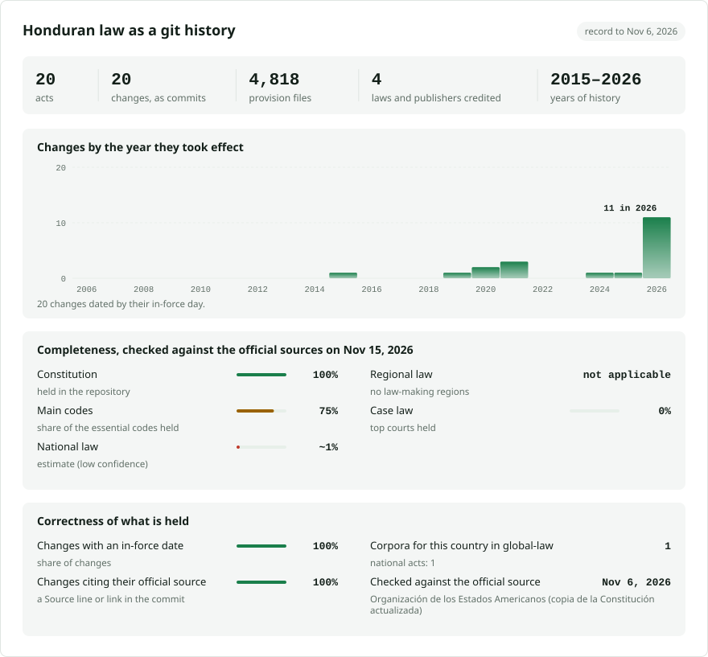

# Honduras: law history in git

[Español](README.md) · **English**

<picture>
<source media="(prefers-color-scheme: dark)" srcset="data/effort-dark.svg">

</picture>

The law of Honduras as a git history: one file per article, one commit per version on the day in its `In-force:` trailer, and the act or publisher behind each version as the commit's author. The sources used here give each act as one text, a consolidated edition or the text as published in La Gaceta, with no earlier texts, so each act has one version for now; a newer text goes on top as a new commit, and `git log` and `git blame` then show what changed. Picking a date gives the text this record holds that day.

Part of [lexifina/global-law](https://github.com/lexifina/global-law), one git history for every country's law: this is Honduras' national law, which global-law reads at `honduras/national/acts/`.

**What is in it now:** the Constitution of 1982, 8 codes (among them the Civil, Penal, Criminal Procedure, Labour and Commercial codes), 372 decrees of the Congreso Nacional, 122 executive decrees and 200 acuerdos published in La Gaceta: 703 acts and 37,937 provisions. The layout is in [`STRUCTURE.md`](STRUCTURE.md); each act's own `README.md` lists its provisions.

Each act is a folder with Spanish names: the Constitution is `constitucion/` (its headings are the `seccion-` files), the codes are in `codigos/` (`codigos/codigo-del-trabajo/art-346.md` is Article 346 of the Código del Trabajo, Decreto 189-59, on the length of paid annual leave), decrees in `decretos/<año>/<NNN>-<objeto>/`, executive decrees (PCM) in `decretos-ejecutivos/<año>/` and acuerdos in `acuerdos/<año>/`. A decree that amends another law is one file, `texto.md`. [`data/paths.json`](data/paths.json) maps each act id to its folder.

The text is in Spanish, the official language, as each source prints it. An English translation is not part of this record.

## Questions as git commands

| Question | Command |
| --- | --- |
| Every change to Article 346 of the Código del Trabajo | `git log -p --word-diff --follow -- codigos/codigo-del-trabajo/art-346.md` |
| Which act wrote each line of Article 346? | `git blame codigos/codigo-del-trabajo/art-346.md` |
| Every version of the Código del Trabajo, with the day of each | `git log --diff-filter=r --format="%h %(trailers:key=In-force,valueonly,separator=) %an" -- codigos/codigo-del-trabajo codigo-del-trabajo ":^*/README.md"` |
| Article 346 as held on 1 January 2020 | `python tools/on.py 2020-01-01 codigos/codigo-del-trabajo art-346` |

On 2026-11-10 the acts moved to their present folders: `--follow` and the old folder name (`codigo-del-trabajo`) reach the history before the move, and `--diff-filter=r` leaves the move itself out.

**Outside git**, we also host this record publicly, for free:

- **[Ask Claude about Honduran law](https://global-law.lexifina.com/v1/try_claude?country=honduras)**: opens Claude with a first question ready.
- **[Ask ChatGPT](https://global-law.lexifina.com/v1/try_chatgpt?country=honduras)**: the same question in ChatGPT.
- **[Search Honduran law on our site](https://lexifina.com/law?country=honduras&q=vacaciones)**: a search for "vacaciones" (paid leave), with each provision's text and its versions, no account needed.
- **[Developer REST API](https://global-law.lexifina.com/v1/search_law?query=vacaciones&jurisdiction=honduras)**: the same search as JSON, with no key. See the [documentation here](https://lexifina.com/api/global-law).

Both assistants read the record through the free Global law connector (MCP, `https://global-law.lexifina.com/mcp`); the first time, the chat gives you the link that adds it. Ask in Spanish or in English.

**Host it yourself easily.** All it takes is git and Python, and the tools run on your machine:

```sh
git clone --depth 1 https://github.com/lexifina/global-law && cd global-law
python3 tools/countries.py add honduras/national/acts
python3 tools/law.py show 2026-01-01 honduras/national/acts/codigos/codigo-del-trabajo/art-346.md
```

Opened in Claude Code, Cursor, VS Code or Codex, the clone also starts a local MCP server with the same tools ([MCP.md](https://github.com/lexifina/global-law/blob/main/MCP.md)).

## Dates

Each commit is dated at noon, America/Tegucigalpa, on the day in its `In-force:` trailer. With one text per act, that day is the text's, not the day the act first took effect (the Constitution's was 20 January 1982, art. 379):

- for the Constitution, 28 January 2021, when La Gaceta No. 35,500 published the last reform its footnotes name (Decreto 3-2021, ratifying Decreto 192-2020), as the copy says only "actualizada noviembre 2021";
- for the Código del Trabajo (2 March 2015), the Código Civil (16 September 2020) and the Código Procesal Penal (26 November 2021), the date of the edition's PDF;
- for the Código Penal, 25 June 2020, the day Art. 635, as reformed by Decreto 46-2020, set for it to take effect;
- for the codes of ethics and the decrees, the day each one's own clause gives: its La Gaceta publication, or for the customs code its approval on 29 July 2021.

The Código Penal is credited to Decreto 130-2017. Every other version is the "oldest version available", credited to a publisher: CEDIJ (Poder Judicial) for the Código Civil and the Código Procesal Penal, the Tribunal Superior de Cuentas for the codes of ethics, and the Organization of American States, the repository's default publisher, for the Constitution and also for the Código del Trabajo and the 13 decrees, although those come from the Tribunal Superior de Cuentas (see Sources). The committer is Lexifina.

## How it is checked

- `tools/check_repo.py` reads every version back from git on the day it took effect and on the day before, and compares it with the corpus: 20 versions of 20 acts, 0 mismatches. No second build has been compared yet.
- The text is read from each PDF's text layer; in the codes, paragraphs are rebuilt from the line layout, and the decrees and codes of ethics are cut from their La Gaceta issues at the source's page boundaries, without OCR.
- Every commit's trailers parse; there are no merge commits, no commit dates that go backwards and none after the build. The corpus's sha256, the builder's hashes and every decision made by hand are in [`REPRODUCE.md`](REPRODUCE.md).
- [vulnerabilities/](vulnerabilities/README.en.md): possible drafting mistakes in this law, found by global-law's detectors and checked by hand. Not run yet.

## What it does not show

- **Reforms after each text.** The Constitution stops at its November 2021 copy; the Código Penal is the 2019 Gaceta text, without later reforms (Decretos 93-2021, 59-2024, 84-2026, 103-2026 and 111-2026 among them); the Código del Trabajo stops at Decreto 278-2013, the Código Procesal Penal at Decreto 93-2021, and the Código Civil at May 2018.
- **Earlier texts, and which decree made each change.** No source used gives past versions, so `git blame` names the publisher, not the reforming decree; the footnotes naming reforms are left out.
- **The editors' matter.** In the codes, book, title and chapter headings, running heads, page numbers, the enacting formula and signatures are left out; the Constitution keeps its headings.
- **The rest of Honduras' law.** The Código de Comercio, other decrees of the Congreso Nacional, regulations and court decisions are not here.

## Sources

| Source | Kind | Past versions | Notes |
| --- | --- | --- | --- |
| [Organization of American States](https://www.oas.org/ext/Portals/33/adam/Content/RsU8CsGIXU29uci6sllzCw/Text/ConstituciondelaRepublica%28actualizadanoviembre2021%29.pdf) | Constitución de la República (Decreto 131 de 1982), "actualizada noviembre 2021" | no | Not on a Honduran official site, and the consolidator is not named: check it against La Gaceta |
| [Tribunal Superior de Cuentas](https://www.tsc.gob.hn/biblioteca/index.php/leyes) | La Gaceta texts: the Código Penal (Decreto 130-2017), the codes of ethics, the 13 decrees; the CEDIJ edition of the Código del Trabajo | no | The Código Penal as published in La Gaceta No. 34,940 of 10 May 2019 |
| [Tribunal Superior de Cuentas, Biblioteca](https://www.tsc.gob.hn/biblioteca/) | La Gaceta extracts: decrees, executive decrees and acuerdos, dated by their commencement clause and the issue's date | yes, each on its day | The publisher's PDF text layer, no OCR of ours |
| [WIPO Lex](https://www.wipo.int/wipolex/es/legislation/details/2143) | Código de Comercio (Decreto 73-50) | no | Secondary copy: no official open copy found |
| CEDIJ, Poder Judicial | [Código Procesal Penal](https://web.archive.org/web/20211228215105/http://www.poderjudicial.gob.hn/CEDIJ/Leyes/Documents/CodigoProcesalPenal%28ActualizadoNoviembre2021%29.pdf) (Decreto 9-99-E) and [Código Civil](https://web.archive.org/web/20211228214249/http://www.poderjudicial.gob.hn/CEDIJ/Leyes/Documents/C%C3%B3digoCivil%28actualizadomayo2018%29.pdf) (Decreto 76-1906), with their reforms | no | Read from Internet Archive copies of December 2021 |

## Licence

See [`LICENSE`](LICENSE). The sources state no licence; the texts are reproduced as official legal texts, with attribution to the bodies that published them, and the Organization of American States does not endorse this repository. Lexifina's arrangement, tables, commit messages and tools are dedicated to the public domain under CC0 1.0.

No AI model wrote, translated or corrected legal text, and none runs when the history is built; the scripts were written by Claude Code running Claude Opus 5.5, and for the codes of ethics and the decrees a language model chose the official text regions and page boundaries in the PDFs (see [`REPRODUCE.md`](REPRODUCE.md)).

## Visualisations

- [visualisations/](visualisations/README.en.md): charts drawn from this repository. Not drawn yet.

## More

From [lexifina/global-law](https://github.com/lexifina/global-law):

- [FEATURES.md](https://github.com/lexifina/global-law/blob/main/FEATURES.md): every feature, and what every corpus must support (`git blame`, `law.py`, the MCP tools)
- [FAQ.md](https://github.com/lexifina/global-law/blob/main/FAQ.md): questions and answers · [CONTRIBUTING.md](https://github.com/lexifina/global-law/blob/main/CONTRIBUTING.md): proposing changes · [MCP.md](https://github.com/lexifina/global-law/blob/main/MCP.md): the MCP server · [REPRODUCE.md](https://github.com/lexifina/global-law/blob/main/REPRODUCE.md): how it was built · [CHANGELOG.md](https://github.com/lexifina/global-law/blob/main/CHANGELOG.md)
- [FRESHNESS.md](https://github.com/lexifina/global-law/blob/main/FRESHNESS.md): how current each corpus is · [Monitoring](https://github.com/lexifina/global-law/tree/main/monitoring): whether updates are running · [WATCHING.md](https://github.com/lexifina/global-law/blob/main/WATCHING.md): how each official source is watched for changes
- [performance/](https://github.com/lexifina/global-law/tree/main/performance): how fast the tools are, measured
- [visualisations/](https://github.com/lexifina/global-law/tree/main/visualisations): charts and bridges across the world's law
- [Vulnerabilities](https://github.com/lexifina/global-law/tree/main/vulnerabilities): mistakes in legislation as published
