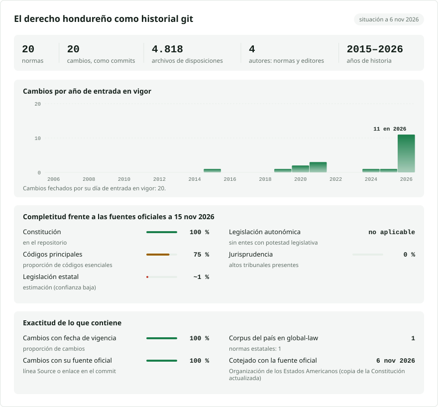

# Honduras: historia del derecho en git

**Español** · [English](README.en.md)

<picture>
<source media="(prefers-color-scheme: dark)" srcset="data/es/effort-dark.svg">

</picture>

El derecho de Honduras como historial de git: un archivo por artículo, un commit por versión, fechado el día que indica su trailer `In-force:`, y la norma o el editor de cada versión como autor del commit. Las fuentes usadas aquí dan cada norma como un solo texto, una edición consolidada o el texto tal como se publicó en La Gaceta, sin textos anteriores, por lo que cada norma tiene por ahora una sola versión; un texto más reciente se añade encima como un nuevo commit, y `git log` y `git blame` muestran entonces qué cambió. Al elegir una fecha se obtiene el texto que este registro contiene ese día.

Forma parte de [lexifina/global-law](https://github.com/lexifina/global-law), un único historial de git para el derecho de todos los países: este es el derecho nacional de Honduras, que global-law lee en `honduras/national/acts/`.

**Qué contiene ahora:** la Constitución de 1982, 8 códigos (entre ellos el Civil, Penal, Procesal Penal, del Trabajo y de Comercio), 56 decretos del Congreso Nacional, 1 decretos ejecutivos y 1 acuerdos publicados en La Gaceta: 67 normas y 9.063 disposiciones. La estructura está en [`STRUCTURE.md`](STRUCTURE.md); el `README.md` de cada norma enumera sus disposiciones.

Cada norma es una carpeta con nombres en español: la Constitución es `constitucion/` (sus encabezados son los archivos `seccion-`), los códigos están en `codigos/` (`codigos/codigo-del-trabajo/art-346.md` es el artículo 346 del Código del Trabajo, Decreto 189-59, sobre la duración de las vacaciones anuales remuneradas), los decretos en `decretos/<año>/<NNN>-<objeto>/`, los decretos ejecutivos (PCM) en `decretos-ejecutivos/<año>/` y los acuerdos en `acuerdos/<año>/`. Un decreto que reforma otra ley es un solo archivo, `texto.md`. [`data/paths.json`](data/paths.json) relaciona el id de cada norma con su carpeta.

El texto está en español, el idioma oficial, tal como lo imprime cada fuente. Una traducción al inglés no forma parte de este registro.

## Preguntas como comandos de git

| Pregunta | Comando |
| --- | --- |
| Cada cambio del artículo 346 del Código del Trabajo | `git log -p --word-diff --follow -- codigos/codigo-del-trabajo/art-346.md` |
| ¿Qué norma escribió cada línea del artículo 346? | `git blame codigos/codigo-del-trabajo/art-346.md` |
| Cada versión del Código del Trabajo, con el día de cada una | `git log --diff-filter=r --format="%h %(trailers:key=In-force,valueonly,separator=) %an" -- codigos/codigo-del-trabajo codigo-del-trabajo ":^*/README.md"` |
| El artículo 346 tal como consta el 1 de enero de 2020 | `python tools/on.py 2020-01-01 codigos/codigo-del-trabajo art-346` |

El 10 de noviembre de 2026 las normas pasaron a sus carpetas actuales: `--follow` y el nombre de la carpeta anterior (`codigo-del-trabajo`) alcanzan el historial anterior al traslado, y `--diff-filter=r` deja fuera el propio traslado.

**Fuera de git**, también alojamos este registro de forma pública y gratuita:

- **[Pregunte a Claude sobre el derecho hondureño](https://global-law.lexifina.com/v1/try_claude?country=honduras)**: abre Claude con una primera pregunta ya preparada.
- **[Pregunte a ChatGPT](https://global-law.lexifina.com/v1/try_chatgpt?country=honduras)**: la misma pregunta en ChatGPT.
- **[Busque en el derecho hondureño en nuestro sitio](https://lexifina.com/law?country=honduras&q=vacaciones)**: una búsqueda de "vacaciones", con el texto de cada disposición y sus versiones, sin necesidad de cuenta.
- **[API REST para desarrolladores](https://global-law.lexifina.com/v1/search_law?query=vacaciones&jurisdiction=honduras)**: la misma búsqueda en JSON, sin clave. Consulte la [documentación aquí](https://lexifina.com/api/global-law).

Ambos asistentes leen el registro mediante el conector gratuito Global law (MCP, `https://global-law.lexifina.com/mcp`); la primera vez, el chat le da el enlace para añadirlo. Pregunte en español o en inglés.

**Alójelo usted mismo fácilmente.** Solo hacen falta git y Python, y las herramientas se ejecutan en su propio equipo:

```sh
git clone --depth 1 https://github.com/lexifina/global-law && cd global-law
python3 tools/countries.py add honduras/national/acts
python3 tools/law.py show 2026-01-01 honduras/national/acts/codigos/codigo-del-trabajo/art-346.md
```

Abierto en Claude Code, Cursor, VS Code o Codex, el clon también inicia un servidor MCP local con las mismas herramientas ([MCP.md](https://github.com/lexifina/global-law/blob/main/MCP.md)).

## Fechas

Cada commit está fechado al mediodía, hora de America/Tegucigalpa, del día que indica su trailer `In-force:`. Como hay un solo texto por norma, ese día es el del texto, no el día en que la norma entró en vigencia por primera vez (la Constitución entró en vigencia el 20 de enero de 1982, art. 379):

- para la Constitución, el 28 de enero de 2021, cuando La Gaceta No. 35,500 publicó la última reforma que nombran sus notas al pie (Decreto 3-2021, que ratifica el Decreto 192-2020), ya que la copia solo dice "actualizada noviembre 2021";
- para el Código del Trabajo (2 de marzo de 2015), el Código Civil (16 de septiembre de 2020) y el Código Procesal Penal (26 de noviembre de 2021), la fecha del PDF de la edición;
- para el Código Penal, el 25 de junio de 2020, el día que el art. 635, reformado por el Decreto 46-2020, fijó para su entrada en vigencia;
- para los códigos de ética y los decretos, el día que indica su propia cláusula: su publicación en La Gaceta o, en el caso del código aduanero, su aprobación el 29 de julio de 2021.

El Código Penal se atribuye al Decreto 130-2017. Todas las demás versiones son la "oldest version available" (la versión más antigua disponible), atribuida a un editor: el CEDIJ (Poder Judicial) para el Código Civil y el Código Procesal Penal, el Tribunal Superior de Cuentas para los códigos de ética, y la Organización de los Estados Americanos, el editor predeterminado del repositorio, para la Constitución y también para el Código del Trabajo y los 13 decretos, aunque estos proceden del Tribunal Superior de Cuentas (véase Fuentes). El committer es Lexifina.

## Cómo se comprueba

- `tools/check_repo.py` vuelve a leer desde git cada versión el día en que entró en vigencia y el día anterior, y la compara con el corpus: 20 versiones de 20 normas, 0 discrepancias. Todavía no se ha comparado una segunda construcción.
- El texto se lee de la capa de texto de cada PDF; en los códigos, los párrafos se reconstruyen a partir de la disposición de las líneas, y los decretos y los códigos de ética se recortan de sus números de La Gaceta en los límites de página de la fuente, sin OCR.
- Los trailers de todos los commits se pueden analizar; no hay commits de fusión (merge), ni fechas de commit que retrocedan, ni ninguna posterior a la construcción. El sha256 del corpus, los hashes del constructor y cada decisión tomada a mano están en [`REPRODUCE.md`](REPRODUCE.md).
- [vulnerabilities/](vulnerabilities/): posibles errores de redacción en este derecho, hallados por los detectores de global-law y revisados a mano. Aún no se ha ejecutado.

## Lo que no muestra

- **Las reformas posteriores a cada texto.** La Constitución se detiene en su copia de noviembre de 2021; el Código Penal es el texto de La Gaceta de 2019, sin reformas posteriores (entre ellas los Decretos 93-2021, 59-2024, 84-2026, 103-2026 y 111-2026); el Código del Trabajo se detiene en el Decreto 278-2013, el Código Procesal Penal en el Decreto 93-2021 y el Código Civil en mayo de 2018.
- **Los textos anteriores, ni qué decreto hizo cada cambio.** Ninguna de las fuentes usadas da versiones pasadas, por lo que `git blame` nombra al editor, no al decreto reformatorio; se omiten las notas al pie que nombran las reformas.
- **El material editorial.** En los códigos se omiten los encabezados de libro, título y capítulo, los encabezados de página, los números de página, la fórmula de promulgación y las firmas; la Constitución conserva sus encabezados.
- **El resto del derecho hondureño.** El Código de Comercio, los demás decretos del Congreso Nacional, los reglamentos y las resoluciones judiciales no están aquí.

## Fuentes

| Fuente | Tipo | Versiones anteriores | Notas |
| --- | --- | --- | --- |
| [Organización de los Estados Americanos](https://www.oas.org/ext/Portals/33/adam/Content/RsU8CsGIXU29uci6sllzCw/Text/ConstituciondelaRepublica%28actualizadanoviembre2021%29.pdf) | Constitución de la República (Decreto 131 de 1982), "actualizada noviembre 2021" | no | No figura en un sitio oficial hondureño, y no se nombra a quien la consolidó: contrástela con La Gaceta |
| [Tribunal Superior de Cuentas](https://www.tsc.gob.hn/biblioteca/index.php/leyes) | Textos de La Gaceta: el Código Penal (Decreto 130-2017), los códigos de ética, los 13 decretos; la edición del CEDIJ del Código del Trabajo | no | El Código Penal tal como se publicó en La Gaceta No. 34,940 del 10 de mayo de 2019 |
| [Tribunal Superior de Cuentas, Biblioteca](https://www.tsc.gob.hn/biblioteca/) | Extractos de La Gaceta: decretos, decretos ejecutivos y acuerdos, fechados por su cláusula de vigencia y la fecha del número de La Gaceta | sí, cada uno en su fecha | Capa de texto del PDF del editor, sin OCR propio |
| [WIPO Lex](https://www.wipo.int/wipolex/es/legislation/details/2143) | Código de Comercio (Decreto 73-50) | no | Copia secundaria: no hallamos copia oficial abierta |
| CEDIJ, Poder Judicial | [Código Procesal Penal](https://web.archive.org/web/20211228215105/http://www.poderjudicial.gob.hn/CEDIJ/Leyes/Documents/CodigoProcesalPenal%28ActualizadoNoviembre2021%29.pdf) (Decreto 9-99-E) y [Código Civil](https://web.archive.org/web/20211228214249/http://www.poderjudicial.gob.hn/CEDIJ/Leyes/Documents/C%C3%B3digoCivil%28actualizadomayo2018%29.pdf) (Decreto 76-1906), con sus reformas | no | Leídos de copias del Internet Archive de diciembre de 2021 |

## Licencia

Véase [`LICENSE`](LICENSE). Las fuentes no indican ninguna licencia; los textos se reproducen como textos jurídicos oficiales, con atribución a los órganos que los publicaron, y la Organización de los Estados Americanos no respalda este repositorio. La ordenación hecha por Lexifina, las tablas, los mensajes de commit y las herramientas se dedican al dominio público bajo CC0 1.0.

Ningún modelo de IA escribió, tradujo ni corrigió texto jurídico, y ninguno se ejecuta al construir el historial; los scripts los escribió Claude Code con Claude Opus 5.5, y para los códigos de ética y los decretos un modelo de lenguaje eligió las regiones de texto oficial y los límites de página en los PDF (véase [`REPRODUCE.md`](REPRODUCE.md)).

Esta es una traducción de la versión inglesa ([README.en.md](README.en.md)); si difieren, prevalece la versión inglesa.

## Visualizaciones

- [visualisations/](visualisations/): gráficos hechos a partir de este repositorio. Aún no se han hecho.

## Más información

Del repositorio [lexifina/global-law](https://github.com/lexifina/global-law) (páginas en inglés):

- [FEATURES.md](https://github.com/lexifina/global-law/blob/main/FEATURES.md): todas las funciones y lo que cada corpus debe admitir (`git blame`, `law.py`, herramientas MCP)
- [FAQ.md](https://github.com/lexifina/global-law/blob/main/FAQ.md): preguntas y respuestas · [CONTRIBUTING.md](https://github.com/lexifina/global-law/blob/main/CONTRIBUTING.md): proponer cambios · [MCP.md](https://github.com/lexifina/global-law/blob/main/MCP.md): servidor MCP · [REPRODUCE.md](https://github.com/lexifina/global-law/blob/main/REPRODUCE.md): cómo se ha construido · [CHANGELOG.md](https://github.com/lexifina/global-law/blob/main/CHANGELOG.md)
- [FRESHNESS.md](https://github.com/lexifina/global-law/blob/main/FRESHNESS.md): lo actualizado que está cada corpus · [Supervisión](https://github.com/lexifina/global-law/tree/main/monitoring): si las actualizaciones funcionan · [WATCHING.md](https://github.com/lexifina/global-law/blob/main/WATCHING.md): cómo se vigila cada fuente oficial para detectar cambios
- [performance/](https://github.com/lexifina/global-law/tree/main/performance): la rapidez de las herramientas, medida
- [visualisations/](https://github.com/lexifina/global-law/tree/main/visualisations): gráficos y conexiones a través del derecho de todo el mundo
- [Vulnerabilidades](https://github.com/lexifina/global-law/tree/main/vulnerabilities): errores en las normas tal como se publicaron
